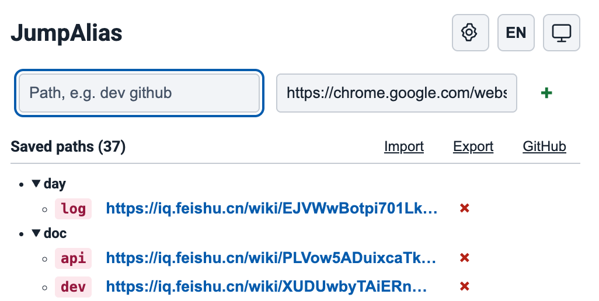
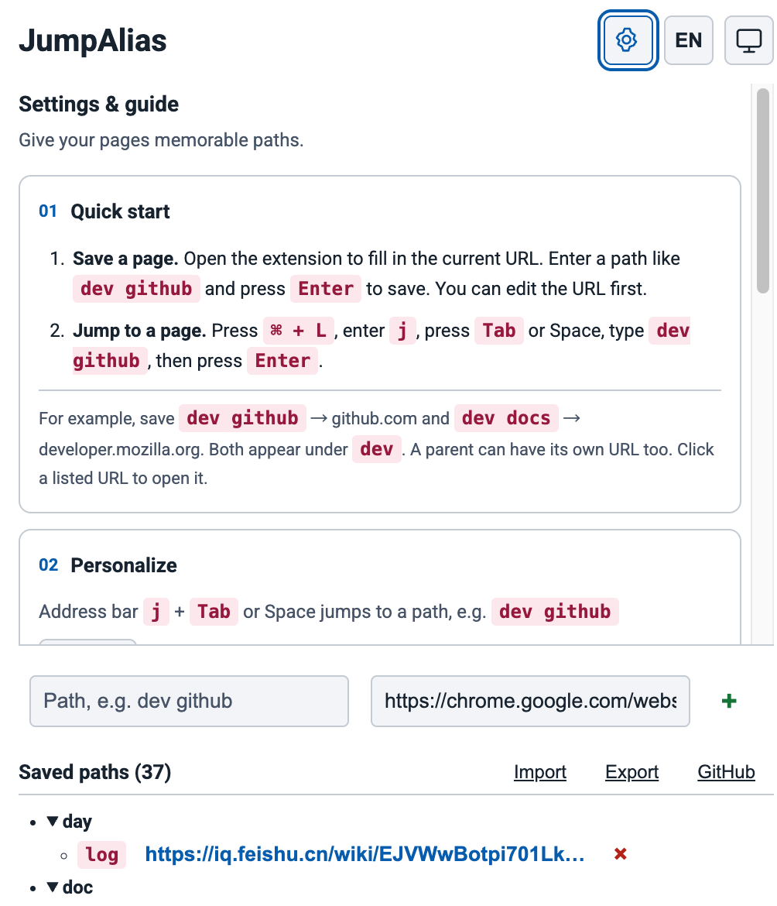

# JumpAlias

Give your pages memorable paths. JumpAlias is a lightweight Chrome extension for saving frequently visited URLs and opening them directly from the address bar.

[](https://chromewebstore.google.com/detail/jumpalias/gcfdhmapdpniheoankhkkpofajgcmibd)     [](LICENSE)

**English** · [简体中文](README.zh-CN.md)

Save GitHub as `dev github`, then type `j` → **Tab** or **Space** → `dev github` → **Enter** in the address bar. No bookmark hunting or long URLs to remember.

## Why install JumpAlias?

- **Open recurring pages faster.** Give repositories, documentation and everyday tools short, memorable aliases.
- **Organize paths as a tree.** `dev github` and `dev docs` share the `dev` parent. Any parent can also have its own URL.
- **Save the page you are viewing.** Open the popup and the current URL is filled in automatically; enter a path and press Enter.
- **Keep your setup portable.** Sync through Chrome or use JSON import and export for backup and migration.

## Screenshots

### Saved paths at a glance

Add a path at the top, browse expandable folders, and click a saved URL to open it. Duplicate URL reminders help you avoid accidental duplicates; you can still confirm another alias for the same address.



### Settings when you need them

The gear opens the usage guide, shortcut settings and sync information. Language and theme controls stay in the header. Choose English or Chinese, and system, light or dark appearance.



Screenshots show an example configuration; saved paths are user-defined.

## Quick start

### Install from Chrome Web Store

Install JumpAlias directly from the [Chrome Web Store](https://chromewebstore.google.com/detail/jumpalias/gcfdhmapdpniheoankhkkpofajgcmibd).

### Install from source

1. Download this repository or clone `https://github.com/jiamadi/jumpalias.git`.
2. Open `chrome://extensions/` and enable **Developer mode**.
3. Click **Load unpacked** and select the repository's `extension` directory.

### Save a page

Open the popup using the toolbar icon or the default save shortcut:

| System | Default shortcut |
| --- | --- |
| macOS | `⌘ + Shift + K` |
| Windows / Linux | `Ctrl + Shift + K` |

The current URL is filled in automatically. Enter `dev github`, then press **Enter** or click **+**. The popup displays Chrome's actual assigned shortcut; change it at `chrome://extensions/shortcuts` if needed. Chrome may leave a conflicting shortcut unassigned.

### Jump to a page

1. Focus the address bar: `⌘ + L` on macOS or `Ctrl + L` on Windows/Linux.
2. Type `j`, then press **Tab** or **Space**.
3. Type a saved path and press **Enter**.

| Path | URL |
| --- | --- |
| `dev github` | `https://github.com` |
| `dev docs` | `https://developer.mozilla.org` |
| `work mail` | `https://mail.google.com` |
| `settings` | `chrome://settings/` |

The default trigger is `j`. Chrome stores it in `manifest.json`; changing it requires replacing the configuration and reloading the extension. Tab and Space are fixed activation keys.

## Sync and backup

Paths sync individually through `chrome.storage.sync`, using timestamps and device IDs to resolve conflicting edits. Deletions are acknowledged by active devices before cleanup; devices inactive for more than 30 days rebuild from the cloud with a local recovery backup.

- Cross-device sync requires Chrome Sync enabled, the same Google account, and the same extension ID. Unpacked installations do not automatically guarantee the same ID.
- Chrome Sync allows 100 KB total, 8 KB per item, and 512 items. Device records and pending deletions also consume quota. This is not unlimited storage or iCloud sync.
- **Export** copies paths as JSON to the clipboard; save that text as a `.json` file for backup.
- **Import** reads a JSON file. Imported paths replace existing entries with the same path.

```json
{
  "dev github": "https://github.com",
  "dev docs": "https://developer.mozilla.org"
}
```

## Supported addresses

Save `https://`, `http://`, `chrome://` and `chrome-extension://` URLs. Opening certain internal or extension pages remains subject to Chrome restrictions and whether the target extension is installed.

## Development

No build step or third-party JavaScript dependencies are required.

```sh
node --test tests/*.test.cjs
```

```text
extension/  Manifest V3 extension, popup and synchronization modules
tests/      Synchronization and duplicate-URL regression tests
docs/       Synchronization design and screenshots
```

The extension requests `storage`, `clipboardWrite` and `tabs` for saved paths, JSON export, and capturing the current URL. See [synchronization architecture](docs/synchronization.md) for implementation details.

## Contributing

[Report a bug or suggest a feature](https://github.com/jiamadi/jumpalias/issues). Include reproduction steps and your Chrome version; remove private URLs from reports and screenshots.

## References

- [Omnibox-Shortcuts](https://github.com/zohaib2002/Omnibox-Shortcuts)

## License

[MIT](LICENSE).
