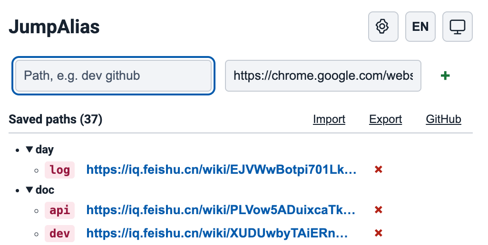
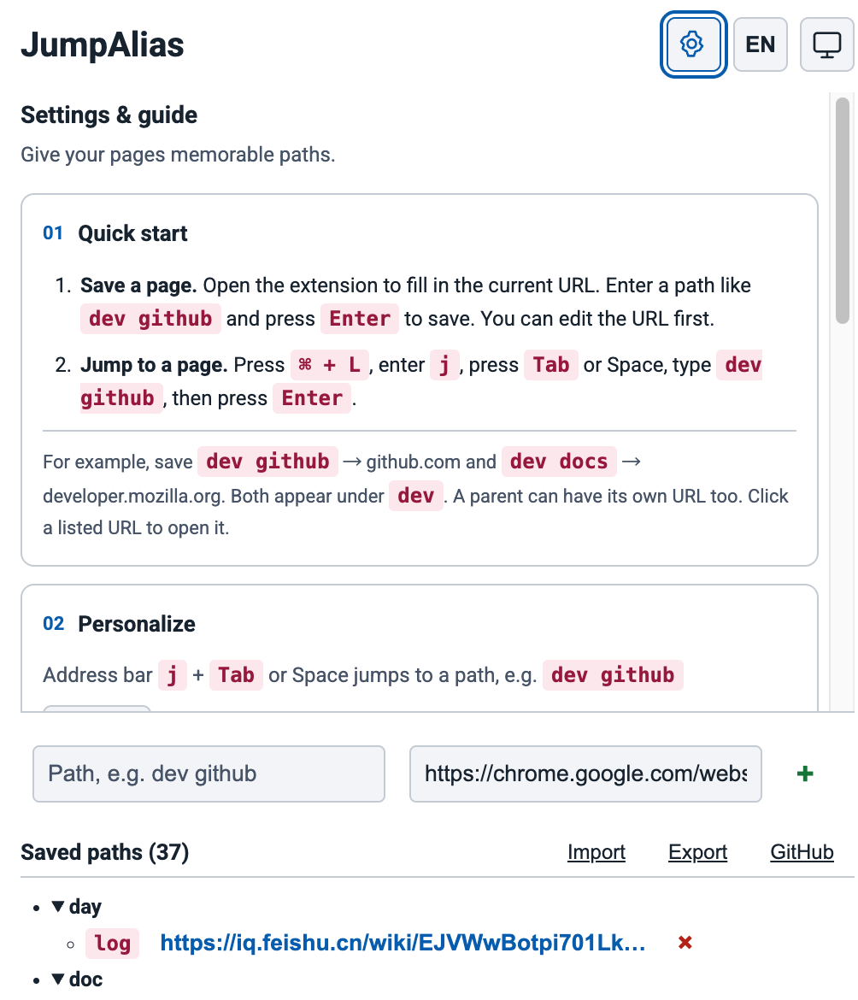

# JumpAlias

给常用页面一个好记的路径。JumpAlias 是一款轻量的 Chrome 扩展，帮你收录常用网址，并直接从地址栏快速打开。

[](https://chromewebstore.google.com/detail/jumpalias/gcfdhmapdpniheoankhkkpofajgcmibd)     [](LICENSE)

[English](README.md) · **简体中文**

把 GitHub 保存为 `dev github`，然后在地址栏输入 `j` → **Tab 或空格** → `dev github` → **Enter**，即可跳转，减少翻找书签和重复输入长网址的时间。

## 为什么安装 JumpAlias？

- **快速打开常用页面**：为代码仓库、文档和日常工具设置简短、好记的路径。
- **树形整理**：`dev github` 与 `dev docs` 自动归到 `dev` 下，父节点也能绑定自己的 URL。
- **快捷收录当前页面**：打开插件自动填入当前 URL，输入路径后回车即可保存。
- **方便备份与迁移**：支持 Chrome 同步，以及 JSON 导入、导出。

## 界面预览

### 常用路径，一目了然

顶部输入路径即可收录；展开目录查看保存的页面，点击 URL 直接打开。重复添加同一地址时会提示已有路径，你也可以确认继续，为同一地址设置其他别名。



### 需要时再展开设置

点击齿轮，查看使用指南、快捷键设置及同步说明。语言和主题入口位于顶部，支持中英文，以及跟随系统、白天和夜晚三种主题。



截图展示的是示例配置，路径由使用者自行设置。

## 快速开始

### 从 Chrome 网上应用店安装

直接前往 [Chrome 网上应用店 (Chrome Web Store)](https://chromewebstore.google.com/detail/jumpalias/gcfdhmapdpniheoankhkkpofajgcmibd) 点击**添加至 Chrome**即可安装。

### 从源码安装

1. 下载本仓库，或克隆 `https://github.com/jiamadi/jumpalias.git`。
2. 打开 `chrome://extensions/`，开启**开发者模式**。
3. 点击**加载已解压的扩展程序**，选择仓库里的 `extension` 目录。

### 收录页面

点击工具栏中的插件图标，或使用默认收录快捷键：

| 系统 | 默认快捷键 |
| --- | --- |
| macOS | `⌘ + Shift + K` |
| Windows / Linux | `Ctrl + Shift + K` |

插件自动填入当前 URL。输入 `dev github`，按 **Enter** 或点击 **+** 即可保存。插件展示 Chrome 实际绑定的快捷键；需要修改时，前往 `chrome://extensions/shortcuts`。如果快捷键冲突，Chrome 可能不会自动绑定。

### 跳转页面

1. 按 `⌘ + L`（macOS）或 `Ctrl + L`（Windows/Linux）聚焦地址栏。
2. 输入 `j`，按 **Tab 或空格**。
3. 输入已保存的路径，按 **Enter**。

| 路径 | URL |
| --- | --- |
| `dev github` | `https://github.com` |
| `dev docs` | `https://developer.mozilla.org` |
| `work mail` | `https://mail.google.com` |
| `settings` | `chrome://settings/` |

默认地址栏触发词为 `j`。Chrome 将它保存在 `manifest.json` 中，修改触发词需要替换配置并重新加载扩展；Tab 和空格是固定的进入方式。

## 同步与备份

每条路径通过 `chrome.storage.sync` 独立同步，以时间戳和设备 ID 处理修改冲突。删除记录经活跃设备确认后清理；超过 30 天未活跃的设备重新连接时，会保留本地恢复备份，再从云端重建。

- 跨设备同步需要启用 Chrome 同步、使用同一 Google 账号及相同的扩展 ID。手动加载的扩展不保证自动获得相同 ID。
- Chrome 同步上限为总量 100 KB、单项 8 KB、512 个存储项。设备信息和待清理的删除记录也占配额，不支持无限存储或 iCloud 同步。
- **导出**：将路径复制到剪贴板，格式为 JSON；请自行保存成 `.json` 文件作为备份。
- **导入**：选择 JSON 文件导入；相同路径会被导入值覆盖。

```json
{
  "dev github": "https://github.com",
  "dev docs": "https://developer.mozilla.org"
}
```

## 支持的地址

可保存 `https://`、`http://`、`chrome://` 和 `chrome-extension://` 地址。部分内部页面或扩展页面能否打开，仍取决于 Chrome 的限制和目标扩展是否安装。

## 开发

无需构建，也不依赖第三方 JavaScript 包。

```sh
node --test tests/*.test.cjs
```

```text
extension/  Manifest V3 扩展、弹窗与同步模块
tests/      同步及重复 URL 校验的回归测试
docs/       同步设计与界面截图
```

扩展使用 `storage`、`clipboardWrite` 和 `tabs` 权限，分别用于存储路径、导出 JSON 和获取当前页面 URL。技术细节见[同步架构说明](docs/synchronization.md)。

## 参与贡献

欢迎[提交问题或功能建议](https://github.com/jiamadi/jumpalias/issues)。请提供复现步骤与 Chrome 版本，提交前移除截图和描述中的私人地址。

## 参考

- [Omnibox-Shortcuts](https://github.com/zohaib2002/Omnibox-Shortcuts)

## 许可证

采用 [MIT 许可证](LICENSE)，允许使用、修改和分发，请保留版权及许可声明。
